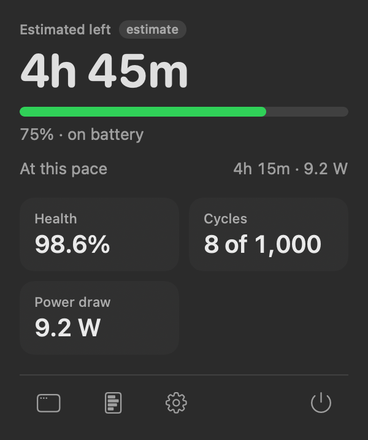
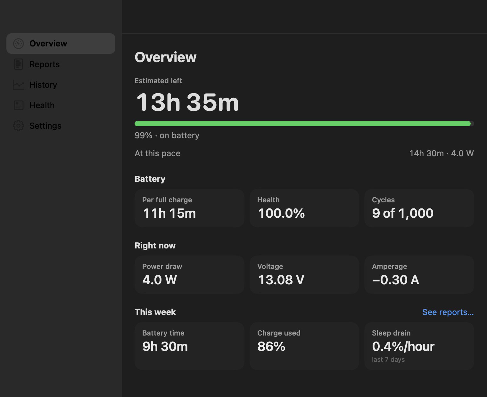
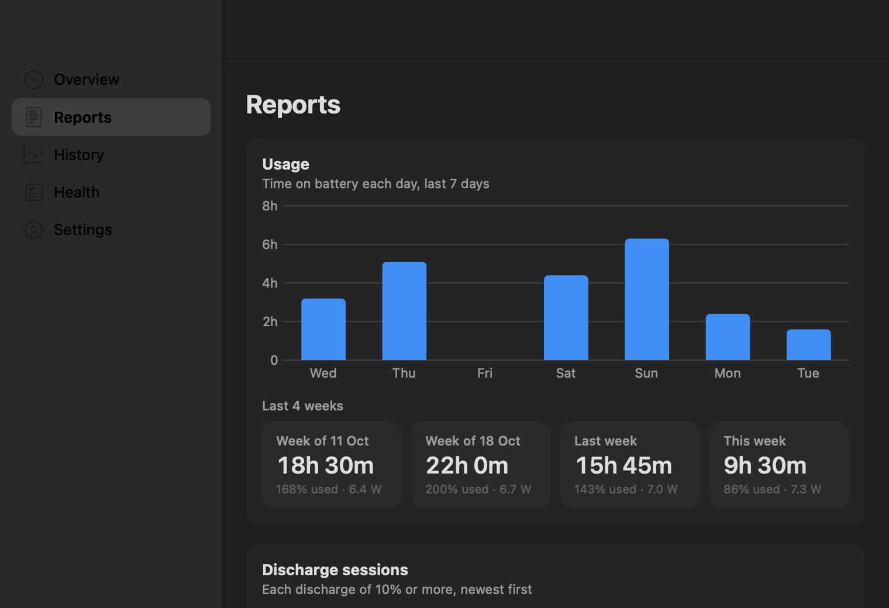

# Battery Meter

Native macOS menu bar app that shows **honest battery runtime**, health details macOS hides, and history over time. Read-only — no charge limiting or cloud sync.

**Requires macOS 27 (Tahoe) or later** and a Mac with a built-in battery.

<p align="center">
  
  
</p>
<p align="center">
  
</p>

## Install with Homebrew

This repo is a [Homebrew tap](https://docs.brew.sh/Taps). After the first [GitHub release](#releases) is published:

```bash
brew tap anllacarpro/battery-meter https://github.com/anllacarpro/battery-meter.git
brew install --cask battery-meter
```

To upgrade later:

```bash
brew update
brew upgrade --cask battery-meter
```

### Install without tapping (one-off)

```bash
brew install --cask https://raw.githubusercontent.com/anllacarpro/battery-meter/main/Casks/battery-meter.rb
```

Use a release tag in the URL instead of `main` if you want a pinned version.

## Build from source

```bash
git clone https://github.com/anllacarpro/battery-meter.git
cd battery-meter
bash scripts/bundle.sh
open "build/Battery Meter.app"
```

Install to `~/Applications`:

```bash
bash scripts/bundle.sh --install
```

Run tests:

```bash
swift test
```

## Releases

Releases are automated: merge the release PR that [release-please](https://github.com/googleapis/release-please-action) keeps open on `main`, and GitHub Actions publishes the zip and opens a PR that updates the Homebrew cask `sha256`. See [RELEASING.md](RELEASING.md) for the full flow.

## Features

- Menu bar time remaining, smoothed from real power draw, with a steady headline and the current pace
- Control Center–style popover with health, cycles, and power draw
- Full window with overview, reports, history, health, and settings
- Reports: weekly usage, discharge sessions, charging habits, health trend, sleep drain, and top battery users
- Health matches macOS Maximum Capacity (capped at 100%) and advises a battery service below 80% health or near the rated cycle count
- Export your history as CSV from Settings
- Launch at login (optional)
- Read-only and private: everything stays on your Mac

## License

[MIT](LICENSE)

## Contributing

Issues and pull requests are welcome. Please run `swift test` before opening a PR.

`main` is protected by [repository rulesets](.github/GOVERNANCE.md) (PR + CI required). Release tags `v*` cannot be deleted via ruleset policy.
